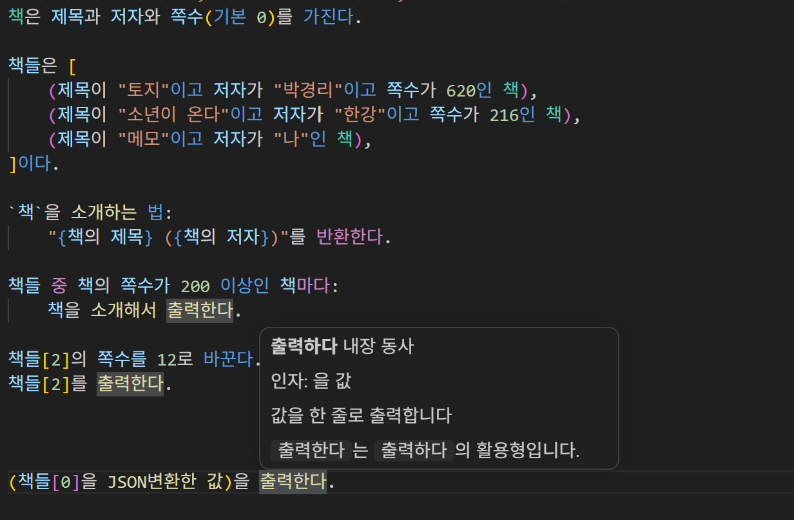
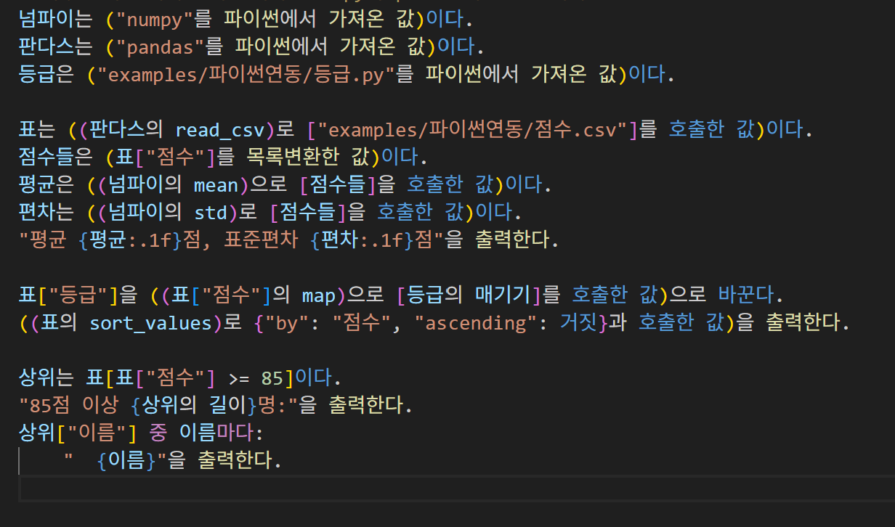

<div align="center">

<picture>
  <source media="(prefers-color-scheme: dark)" srcset="assets/logo-dark.svg">
  
</picture>

# 이음

한국어 문장으로 쓰는 프로그래밍 언어입니다.

</div>

```ieum
`수`를 팩토리얼구하는 법:
    `수`가 1 이하이면:
        1을 반환한다.
    (`수` * ((`수` - 1)을 팩토리얼구한 값))을 반환한다.

(5를 팩토리얼구한 값)을 출력한다.

과일들은 ["사과", "배"]이다.
과일들에 "감"이 없으면:
    과일들에 "감"을 추가한다.
(과일들을 ", "로 연결한 값)을 출력한다.

학생들은 [{"이름": "하나", "점수": 92}, {"이름": "두나", "점수": 75}]이다.
학생들 중 학생의 점수가 80 이상인 학생마다:
    학생의 이름을 출력한다.
```

```text
120
사과, 배, 감
하나
```

<div align="center">





</div>

## 설치

Rust 1.85 이상이 필요합니다. 파이썬 연동에는 빌드할 때와 실행할 때 PATH에 Python 3.8 이상이 있어야 합니다.

```sh
cargo install --path .
cargo install --path . --features python   # 파이썬 모듈을 쓰려면
```

```sh
ieum 파일.이음          # 실행
ieum check 파일.이음    # 실행하지 않고 검사
ieum fmt 파일.이음      # 정리한 코드 출력
ieum test 폴더          # 폴더 안의 test_*.이음 실행
ieum repl               # 대화형 실행
```

편집기에서는 언어 서버 `ieum lsp`를 씁니다. VS Code 확장은 [editors/vscode](editors/vscode)에 있습니다.

## 문서

- [언어 안내](docs/language.md)
- [내장 동사](docs/stdlib.md)

## 예제

| 예제 | 내용 |
| --- | --- |
| [첫걸음](examples/첫걸음.이음) | 출력, 정의와 변경, 큰 정수, 나눗셈 |
| [조건과검색](examples/조건과검색.이음) | 조건 문장, 포함 검사, 사전, 관형절 반복 |
| [함수와반복](examples/함수와반복.이음) | 재귀, 범위 반복, 조건 반복, 클로저 |
| [함수인자](examples/함수인자.이음) | 조사로 정하는 인자, 기본값, 결과 잇기 |
| [자료형](examples/자료형.이음) | 자료형 정의, 값 만들고 바꾸기, JSON |
| [예외와정리](examples/예외와정리.이음) | 오류 처리와 정리 블록 |
| [파일과경로](examples/파일과경로.이음) | 파일 쓰기, 덧붙이기, 읽기, 경로 |
| [폴더정리](examples/폴더정리.이음) | 파일 찾기, 옮기기, 지우기 |
| [함께기다리기](examples/함께기다리기.이음) | 기다리는 일을 `함께` 실행하기 |
| [병렬계산](examples/병렬계산.이음) | 계산을 `병렬로` 여러 코어에 나누기 |
| [피즈버즈](examples/피즈버즈.이음) | `-는지`로 정의한 동사를 조건으로 쓰기 |
| [숫자맞히기](examples/숫자맞히기.이음) | 입력, 무작위 수, 반복 중단 |
| [하노이탑](examples/하노이탑.이음) | 재귀, 명령줄 인자 |
| [에라토스테네스의체](examples/에라토스테네스의체.이음) | 집합으로 거르기, `각각`, 서식 |
| [여덟퀸](examples/여덟퀸.이음) | 백트래킹, 부정 관형절 |
| [생명게임](examples/생명게임.이음) | 튜플 집합, 튜플 키 사전 |
| [재고관리](examples/재고관리.이음) | 자료형, 형용사 함수, 직접 낸 오류 |
| [로그집계](examples/로그집계.이음) | 문자열 나누기, 사전으로 세기, 정렬 |
| [가계부](examples/가계부.이음) | 여러 줄 문자열, 서식으로 맞춘 표 |
| [성적처리](examples/성적처리/시작.이음) | 여러 파일로 나눈 프로그램, CSV, 테스트 |
| [파이썬연동](examples/파이썬연동/시작.이음) | numpy, pandas, `.py` 파일 가져오기. `--features python`으로 빌드해야 합니다 |

파일을 쓰는 예제는 실행한 폴더의 `예제-출력` 아래에 씁니다.
